# 🏨 Awesome Hotel Booking Engine

<p align="center">
  
</p>

<p align="center">
  <a href="https://github.com/ishandutta2007/Awesome-Awesome-Awesome"></a><a href="https://discord.gg/jc4xtF58Ve"></a>
  <a href="https://github.com/ishandutta2007/Awesome-Hotel-Booking-Engine/stargazers"></a>
  <a href="https://github.com/ishandutta2007/Awesome-Hotel-Booking-Engine/network/members"></a>
  <a href="https://github.com/ishandutta2007/Awesome-Hotel-Booking-Engine/pulls"></a>
  <a href="https://github.com/ishandutta2007/Awesome-Hotel-Booking-Engine/blob/main/LICENSE"></a>
  <a href="https://github.com/ishandutta2007"></a>
</p>

---

## 🌟 Top Hotel Booking Engine Ecosystem

**A Curated List of SaaS Platforms & Open-Source GitHub Projects for Direct Hotel Reservations, Booking Engines, Room Inventory Synchronization, Channel Distribution, and Hospitality Management.**

*Keywords: Hotel Booking Engine, Reservation Management System (RMS), Central Reservation System (CRS), Property Management System (PMS), Direct Bookings, Channel Manager, Dynamic Pricing, Rate Parity, Hospitality SaaS, Open-Source Hotel Booking.*

📅 **Last updated: August 2026**

---

### 📖 Introduction

A **Hotel Booking Engine** is the mission-critical digital checkout engine for modern accommodation providers—including independent boutique hotels, luxury resorts, hotel chains, vacation rental operators, and bed & breakfasts. These engines empower properties to accept direct, zero-commission online bookings, display real-time room availability, process secure multi-currency payments, manage dynamic rates and promotional discount codes, and seamlessly synchronize with **Property Management Systems (PMS)**, **Central Reservation Systems (CRS)**, **Global Distribution Systems (GDS)**, and online travel agencies (OTAs) via channel managers.

---

## 📑 Table of Contents

- [☁️ SaaS / Hosted Platforms](#-saashosted-platforms)
- [🔓 Open-Source GitHub Projects](#-open-source-github-projects)
- [🏗️ Architectural Blueprint for Custom Hotel Booking Engines](#️-architectural-blueprint-for-custom-hotel-booking-engines)
- [🤝 How to Contribute](#-how-to-contribute)
- [📈 Star History](#-star-history)
- [⚖️ Disclaimer](#️-disclaimer)

---

## ☁️ SaaS / Hosted Platforms

> 📊 **Market Overview:** The global Hotel Booking Engine and Hospitality Management Software sector is estimated at **$4.5B – $7.5B (projected to reach $10.5B+ by 2034 at an 8.5%–12.2% CAGR)**. The sector is **moderately fragmented**—featuring global enterprise hospitality giants (Amadeus, Sabre) alongside high-growth vertical cloud unicorns (Mews, Hostaway, Cloudbeds, SiteMinder) and agile modular providers, with an accelerating industry-wide trend toward unified PMS, CRS, and direct-booking suite consolidation.

| Platform | Scale / Valuation / Revenue | Description | Pricing (Starting Tier) | Free Tier / Trial Limits |
| :--- | :--- | :--- | :--- | :--- |
| **[Amadeus iHotelier](https://www.amadeus-hospitality.com/)** | **~€25.2B Market Cap** / ~€6.1B Annual Revenue | Enterprise-grade Central Reservation System (CRS) and web booking engine for global hotel chains and luxury resorts. | Starts from ~$450–$500/mo (base platform fee plus per-reservation distribution fees) | No free plan; enterprise live demo and guided technical evaluation on request |
| **[TravelClick / Amadeus CRS](https://www.amadeus-hospitality.com/)** | **Part of Amadeus Group** (~€25.2B Market Cap) | Enterprise hospitality reservation infrastructure supporting direct booking engines, rate optimization, and global GDS distribution. | Starts from ~$500/mo (enterprise CRS tier depending on inventory and channels) | No free plan; enterprise product walkthrough and proof of concept on request |
| **[Mews](https://www.mews.com/)** | **$2.5B Valuation** (Double Unicorn) / ~$200M ARR | Modern cloud-native hospitality ecosystem providing integrated booking engine, PMS, guest kiosk, and embedded payments. | Starts from ~€300/mo (Essentials tier for small independent properties) | No public self-serve trial; live guided sandbox demo upon request |
| **[Hostaway](https://www.hostaway.com/)** | **$1.0B Valuation** (Unicorn) / ~$50M+ ARR ($543M funding) | Premier vacation rental PMS and direct-booking website builder with deep OTA channel synchronization. | Starts from ~$100–$150/mo (scalable per-unit pricing for professional operators) | No self-serve trial; live interactive product demo and portfolio onboarding evaluation upon request |
| **[SiteMinder Booking Engine](https://www.siteminder.com/)** | **~$1.07B Market Cap** (A$1.6B) / ~$251M Annual Revenue | Leading global hotel commerce platform converting website traffic into direct reservations with multi-currency support. | Starts from ~$56–$85/mo ($109–$119/mo for SiteMinder Plus including full booking engine) | 14-day free trial (full feature access, no credit card required) |
| **[Cloudbeds Booking Engine](https://www.cloudbeds.com/)** | **~$1B+ Valuation** / ~$291M Annual Revenue ($250M+ funding) | Seamless commission-free direct booking engine fully synchronized with Cloudbeds PMS, channel manager, and marketplace. | Starts from ~$120/mo (approx. $15–$25/room/mo for small independent properties) | No free tier; 1-on-1 personalized guided product demo with sandbox trial upon request |
| **[Guesty Booking Engine](https://www.guesty.com/)** | **~$900M Valuation** / ~$165M Annual Revenue ($410M+ funding) | Direct-booking website builder and centralized reservation manager within Guesty's hospitality PMS suite. | Starts from $9/listing/mo (Guesty Lite, annual billing) or $23–$29/listing/mo monthly | 14-day free trial on Guesty Lite (up to 3 listings, full features) |
| **[SynXis Booking Engine (Sabre)](https://www.sabre.com/)** | **~$835M Market Cap** / ~$2.8B Annual Revenue | Sabre SynXis enterprise hotel reservation system providing high-conversion direct booking tools and global distribution. | Starts from ~$400/mo base platform fee (plus variable GDS / per-transaction fees) | No free plan; enterprise live demo and technical consultation upon request |
| **[Lodgify](https://www.lodgify.com/)** | **~$200M+ Est. Valuation** / ~$75M Annual Revenue ($37.3M funding) | Vacation rental and boutique accommodation software with direct booking website builder and automated payment processing. | Starts from $14–$20/mo (Starter tier, billed annually) + 1.9% booking fee | 7-day free trial (unlimited listings and website builder test, no credit card required) |
| **[Amenitiz](https://amenitiz.com/)** | **~$150M–$200M Est. Valuation** / ~$16.5M Annual Revenue ($82.5M funding) | All-in-one hospitality operating system offering website builder, booking engine, PMS, and channel manager for independent hoteliers. | Starts from €42–€89/mo (Starter package for independent properties) | No ongoing free plan; live 1-on-1 demo with 14-day trial available on select add-on modules |
| **[Profitroom](https://www.profitroom.com/)** | **~$100M+ Valuation** (MCI Capital majority stake) / ~$14M Revenue | High-conversion direct booking engine 360, automated guest marketing, and omnichannel distribution technology. | Starts from €39/property/mo (Suite Profit group tier) or 3.5% commission/booking + €69/mo channel manager | No free plan; guided product demo and direct booking ROI audit on request |
| **[D-EDGE Booking Engine](https://www.d-edge.com/)** | **Accor Hospitality Group** / ~$50M–$80M Revenue scale | Conversion-optimized booking engine and digital marketing suite powering direct hotel revenue across 150+ countries. | Starts from ~$400/mo (entry tier for independent hotels; scales with room count and add-ons) | No free tier; live demo and testing environment available upon sales consultation |
| **[RMS Cloud](https://www.rmscloud.com/)** | **~$40M–$60M Revenue scale** (Global PMS provider) | Robust cloud property management and direct reservation platform serving hotels, resorts, holiday parks, and serviced apartments. | Starts from ~$55/mo (base module for small operators) | No self-serve trial; free personalized live demo and guided trial environment upon request |
| **[HotelRunner](https://hotelrunner.com/)** | **~$30M–$50M Est. Valuation** / ~$6M+ Revenue ($8.7M funding) | End-to-end hotel commerce platform connecting direct booking widgets, channel manager, POS, and digital sales capabilities. | Starts from $9.95/mo for basic plan | Free plan available for direct booking button & website widget; 14-day free trial on premium modules |
| **[RoomRaccoon](https://roomraccoon.com/)** | **Bootstrapped / €5.3M–€10M+ Revenue** (FT1000 fastest-growing) | All-in-one hotel management system crafted specifically for independent hotels, boutique properties, and B&Bs. | Starts from ~$180–$207/mo (Entry plan, annual billing for boutique properties) | 14 to 30-day free trial account after initial consultation/demo |
| **[STAAH](https://www.staah.com/)** | **~$10M–$20M Revenue scale** (30,000+ properties globally) | Cloud hospitality distribution technology featuring Max Booking Engine, instant voucher engine, and channel manager. | Starts from ~$70–$80/mo (Max Booking Engine & Channel Manager entry tier) | No self-serve trial; live product demo and direct booking consultation upon request |
| **[Rentals United](https://rentalsunited.com/)** | **~$10M–$20M ARR scale** (100k+ managed listings) | Specialized channel distribution engine connecting bookable property inventory to 60+ global and niche travel channels. | Starts from $330/mo (Pro plan for 10–50 listings; single-unit channel connections from ~€107/mo) | No self-serve trial; guided product demonstration and channel distribution audit on request |
| **[Little Hotelier](https://www.littlehotelier.com/)** | **Division of SiteMinder** (~$1.07B parent market cap) | Easy-to-use direct booking engine, front desk, and channel manager specifically tailored for small accommodation businesses. | Starts from $39/mo + 1% direct booking fee (Basics plan) or $109/mo flat (Pro plan) | 30-day free trial (full access to booking engine, channel manager, and front desk) |
| **[WebRezPro](https://webrezpro.com/)** | **~$10M–$15M Revenue scale** (World Web Technologies) | Comprehensive cloud property management software with integrated commission-free direct booking engine. | $10/unit/mo (with a $100/mo minimum for properties under 10 units) | No self-serve trial; full live interactive demo and customized sandbox evaluation upon request |
| **[eZee Reservation](https://www.ezeetechnosys.com/)** | **Division of Yanolja Cloud** ($8B+ parent valuation) | Feature-rich online hotel reservation engine enabling commission-free direct bookings and dynamic promotional packages. | Starts from ~$30–$45/mo (eZee Absolute PMS + Booking Engine bundle ~$30–$70/mo) | 14-day free trial (unlimited features and test room inventory) |
| **[SHR Booking Engine (Windsurfer)](https://shrgroup.com/)** | **Serent Capital Portfolio** / ~$15M–$25M Revenue scale | AI-driven booking engine and Windsurfer Central Reservation System designed to optimize revenue and direct conversions. | Starts from ~$250–$350/mo (base monthly subscription or tiered per-room-per-month rate) | No free plan; live customized platform demonstration on request |
| **[Bookassist](https://www.bookassist.com/)** | **~$10M+ Revenue scale** (Independent European leader) | Award-winning direct booking engine, mobile hotel web technology, and direct revenue management strategy. | Starts from ~€150/mo base subscription + performance commission per direct reservation | No free plan; live customized product demo and booking audit on request |
| **[Vertical Booking](https://www.verticalbooking.com/)** | **Division of Zucchetti Group** (€1.5B+ parent group) | Modular CRS and booking engine suite supporting multi-property hotel chains, dynamic packaging, and corporate bookings. | Starts from ~€200–$250/mo (modular base package depending on room count and channels) | No free plan; live interactive product demo provided on request |
| **[Net Affinity](https://www.netaffinity.com/)** | **~$8M–$15M Revenue scale** (UK & Ireland hotel tech) | Direct booking technology platform combining conversion-optimized booking engines, bespoke web design, and digital marketing. | Starts from ~$800–$900/mo (fixed subscription suite including booking engine and direct marketing) | No free plan; live product demonstration and website conversion audit upon request |
| **[Smoobu](https://www.smoobu.com/)** | **~$5M–$10M Revenue scale** (FE fund portfolio) | Complete vacation rental management software with integrated booking tool, guest communication, and calendar sync. | Starts from €29/mo (~$32/mo) billed annually or €35/mo billed monthly (Professional Flex, 1st unit) | 14-day free trial (full Professional features, no credit card required) |
| **[Hotel-Spider](https://www.hotel-spider.com/)** | **~$3M–$7M Revenue scale** (Swiss hotel tech) | Swiss cloud reservation platform offering direct booking engine (Spider-Booking), channel manager, and central inventory. | Starts from €89/mo (for properties up to 10 rooms via partner marketplace) | 30-day free trial (full access to booking engine & channel manager) |
| **[Sirvoy](https://sirvoy.com/)** | **Bootstrapped / ~$3M–$6M ARR scale** | Cloud hotel reservation system and booking engine built for hotels, motels, guest houses, and hostels. | Starts from $15/mo (Starter plan, single unit) | Forever-free tier for single-unit properties; 14-day free trial for multi-unit Starter & Pro plans (no credit card required) |
| **[WuBook](https://en.wubook.net/)** | **Bootstrapped / ~$3M–$6M ARR scale** | Modular PMS, Channel Manager (WooDoo), and direct booking engine (Zak) designed for independent accommodation providers. | Starts from ~€55/mo for full Zak suite; standalone booking engine module from €18/mo | Free basic PMS account (unlimited time, limited features); 30-day free trial for full Zak suite |
| **[Beds24](https://www.beds24.com/)** | **Bootstrapped / ~$2M–$5M ARR scale** | Highly customizable, API-first property management system and channel manager with embeddable booking widgets. | Starts from €8.40/mo (~$10/mo) for 1–2 rooms (plus optional pay-per-module add-ons) | 14-day free trial (full platform functionality, no credit card required) |
| **[Djubo](https://djubo.com/)** | **Goibibo / MakeMyTrip backed** / ~$2M–$5M ARR | 360-degree hotel tech suite integrating booking engine, CRS, PMS, and channel manager for independent hoteliers. | Starts from ~$46/mo (entry tier) to ₹8,149/mo (~$98–$180/mo for 10+ rooms Master Hotelier suite) | No self-serve trial; live demo and guided testing sandbox upon request |

---

## 🔓 Open-Source GitHub Projects

*Curated open-source hotel reservation systems, booking engine frameworks, headless APIs, and hospitality management platforms on GitHub. Sorted by GitHub star count (descending).*

- **[Strapi](https://github.com/strapi/strapi)** [](https://github.com/strapi/strapi/stargazers)  
  ⚡ *73,000+ Stars* • Leading open-source headless CMS (100% JavaScript/TypeScript). Extensively used to build high-performance, developer-first hotel booking engine APIs, custom room content models, multilingual room descriptions, and dynamic rate backends.

- **[Odoo](https://github.com/odoo/odoo)** [](https://github.com/odoo/odoo/stargazers)  
  🏢 *53,900+ Stars* • Comprehensive open-source business application suite with native website, e-commerce, CRM, accounting, and hotel reservation modules (e.g., Odoo Hotel Management) that provide end-to-end property operations and direct booking.

- **[Cal.com](https://github.com/calcom/cal.com)** [](https://github.com/calcom/cal.com/stargazers)  
  📅 *47,900+ Stars* • Open-source scheduling and booking infrastructure. Provides battle-tested time-slot allocation, calendar synchronization, webhooks, and payment integrations readily adaptable for accommodation check-in/check-out reservation engines.

- **[ERPNext](https://github.com/frappe/erpnext)** [](https://github.com/frappe/erpnext/stargazers)  
  📊 *38,500+ Stars* • Powerful open-source ERP platform built on Frappe. Features native hospitality and restaurant management extensions, invoicing, CRM, and guest management for independent hotels and chains.

- **[Directus](https://github.com/directus/directus)** [](https://github.com/directus/directus/stargazers)  
  🐰 *37,500+ Stars* • Open-source headless data platform that layers real-time REST and GraphQL APIs over SQL databases (PostgreSQL/MySQL), ideal for rapid development of hotel availability engines and room inventory services.

- **[Medusa](https://github.com/medusajs/medusa)** [](https://github.com/medusajs/medusa/stargazers)  
  🛒 *36,000+ Stars* • Modular, headless open-source digital commerce framework in Node.js. Supports bookable inventory units, custom checkout workflows, multi-currency processing, and promotion rule management for hotel websites.

- **[WordPress Core](https://github.com/WordPress/WordPress)** [](https://github.com/WordPress/WordPress/stargazers)  
  🌐 *21,300+ Stars* • The world's most popular open-source CMS. Forms the backbone of thousands of hotel websites utilizing dedicated reservation plugins, availability calendars, and direct booking widgets.

- **[QloApps](https://github.com/Qloapps/QloApps)** [](https://github.com/Qloapps/QloApps/stargazers)  
  🏨 *14,200+ Stars* • The gold-standard open-source hotel management and reservation system. Delivers an out-of-the-box Property Management System (PMS), integrated booking engine, dynamic pricing, real-time availability calendar, and responsive hotel website (OSL-3.0).

- **[Frappe Framework](https://github.com/frappe/frappe)** [](https://github.com/frappe/frappe/stargazers)  
  🐍 *10,600+ Stars* • Full-stack Python & JavaScript web application framework underlying ERPNext, suited for creating bespoke hotel reservation APIs, rate calculators, and back-office hospitality tools.

- **[WooCommerce](https://github.com/woocommerce/woocommerce)** [](https://github.com/woocommerce/woocommerce/stargazers)  
  🛍️ *10,400+ Stars* • Highly customizable open-source commerce platform for WordPress. When paired with WooCommerce Bookings and Accommodation plugins, it delivers a complete direct booking and payment flow.

- **[Drupal Core](https://github.com/drupal/drupal)** [](https://github.com/drupal/drupal/stargazers)  
  💧 *4,200+ Stars* • Flexible open-source CMS platform frequently utilized by luxury hotel groups and destination websites for multilingual reservation portals and enterprise booking workflows.

- **[Hotel Management System (Java/Spring)](https://github.com/tramyardg/hotel-mgmt-system)** [](https://github.com/tramyardg/hotel-mgmt-system/stargazers)  
  ☕ *315+ Stars* • Full-featured hotel booking and customer management system built with Spring Boot, JPA, and Thymeleaf for managing room allocations and reservation workflows.

- **[Flutter Hotel Booking App](https://github.com/sangvaleap/app-flutter-hotel-booking)** [](https://github.com/sangvaleap/app-flutter-hotel-booking/stargazers)  
  📱 *202+ Stars* • Cross-platform mobile hotel booking client in Flutter, demonstrating hotel search, room filtering, date picking, booking summaries, and checkout UI.

- **[Hotelyn](https://github.com/enzoftware/hotelyn)** [](https://github.com/enzoftware/hotelyn/stargazers)  
  🏩 *190+ Stars* • Sleek Flutter hotel booking application UI kit showcasing modern mobile reservation flows, interactive room detail views, and user booking management.

- **[Hotel Booking Engine (Laravel + AngularJS)](https://github.com/andbet39/Hotel)** [](https://github.com/andbet39/Hotel/stargazers)  
  🛠️ *187+ Stars* • Full-stack hotel booking engine implementation demonstrating room rate calculations, date availability checks, and customer reservation checkouts.

- **[Laravel Hotel Booking Demo](https://github.com/LaravelDaily/Hotel-Booking)** [](https://github.com/LaravelDaily/Hotel-Booking/stargazers)  
  🏨 *183+ Stars* • Laravel project showcasing room booking management, customer reservation calendars, rate plans, and automated administration panels.

- **[Hotel Booking UI Flutter](https://github.com/cybdom/hotel_booking_ui)** [](https://github.com/cybdom/hotel_booking_ui/stargazers)  
  🎨 *161+ Stars* • Clean, responsive Flutter mobile UI template for accommodation booking, room discovery, and guest reservation management.

- **[AxonIQ Hotel Demo](https://github.com/AxonIQ/hotel-demo)** [](https://github.com/AxonIQ/hotel-demo/stargazers)  
  🏛️ *129+ Stars* • Event-driven CQRS and Event Sourcing hotel reservation demo built with the Axon Framework & Axon Server, modeling high-concurrency room booking transactions.

- **[Hotel Booking Concept Flutter](https://github.com/LanarsInc/hotel-booking-concept-flutter)** [](https://github.com/LanarsInc/hotel-booking-concept-flutter/stargazers)  
  📱 *109+ Stars* • Mobile concept application for boutique hotel discovery and room reservations created with Flutter and custom animations.

- **[Hotel Reservation Spring MVC](https://github.com/mjstewart/hotel-reservation-springmvc)** [](https://github.com/mjstewart/hotel-reservation-springmvc/stargazers)  
  ☕ *108+ Stars* • Spring Boot MVC web application implementing room availability calendars, guest authentication, reservation booking, and admin reporting.

- **[React Hotel Booking](https://github.com/Solexofficial/react-hotel_booking)** [](https://github.com/Solexofficial/react-hotel_booking/stargazers)  
  ⚛️ *108+ Stars* • React.js single-page application for hotel room reservations, featuring real-time room filtering, availability lookup, and guest checkout.

- **[Phegon Hotel Booking & Management](https://github.com/dennisiluma/phegon-hotel-booking-and-management)** [](https://github.com/dennisiluma/phegon-hotel-booking-and-management/stargazers)  
  🏨 *89+ Stars* • Full-stack hotel reservation and booking management system built with Spring Boot, React, and JWT authentication.

- **[HotelDruid](https://github.com/digital-druid/hoteldruid)** [](https://github.com/digital-druid/hoteldruid/stargazers)  
  🌿 *17+ Stars* • Established open-source hotel management software (AGPL-3.0) supporting multi-unit reservations, room availability calendars, seasonal rates, and direct booking web pages.

- **[Solidres](https://github.com/solidres/solidres)** [](https://github.com/solidres/solidres/stargazers)  
  🧩 Open-source accommodation booking and reservation extension for Joomla and WordPress, featuring tariff management, flexible room types, and channel integration add-ons.

- **[Jomres](https://github.com/Jomres/Jomres)** [](https://github.com/Jomres/Jomres/stargazers)  
  🏖️ Open-source property management and accommodation reservation framework for CMS platforms, supporting single-property and multi-vendor portal setups.

- **[QloApps Documentation](https://github.com/Qloapps/qloapps-docs)** [](https://github.com/Qloapps/qloapps-docs/stargazers)  
  📚 Official open-source developer documentation repository for extending the QloApps booking engine, PMS core, and API integrations.

- **[HotelApp](https://github.com/ziyed/hotelapp)** [](https://github.com/ziyed/hotelapp/stargazers)  
  🏨 Open-source hotel management and reservation project derived from the QloApps ecosystem for studying customizable hotel booking workflows.

---

## 🏗️ Architectural Blueprint for Custom Hotel Booking Engines

```
┌────────────────────────────────────────────────────────────────────────┐
│                          GUEST FRONTEND                                │
│   [React / Next.js / Vue / Flutter / Mobile Web Direct Booking UI]     │
└───────────────────────────────────┬────────────────────────────────────┘
                                    │ HTTPS / REST / GraphQL
┌───────────────────────────────────▼────────────────────────────────────┐
│                             API GATEWAY                                │
│          [Rate Limiting • Caching (Redis) • Auth (Keycloak)]           │
├───────────────────────────────────┬────────────────────────────────────┤
│                                   │                                    │
│   ┌───────────────────────────┐   │   ┌───────────────────────────┐    │
│   │   AVAILABILITY & RATES    │   │   │   RESERVATION ENGINE      │    │
│   │  - Real-time inventory    │   │   │  - Booking workflow       │    │
│   │  - Dynamic rate plans     │   │   │  - Concurrency locking    │    │
│   │  - Promo codes & add-ons  │   │   │  - Cancellation policies  │    │
│   └─────────────┬─────────────┘   │   └─────────────┬─────────────┘    │
│                 │                 │                 │                  │
│   ┌─────────────▼─────────────┐   │   ┌─────────────▼─────────────┐    │
│   │     PAYMENT GATEWAY       │   │   │      CHANNEL MANAGER      │    │
│   │  - Stripe / PayPal        │   │   │  - 2-way OTA sync         │    │
│   │  - Multi-currency         │   │   │  - GDS / CRS connectors   │    │
│   └───────────────────────────┘   │   └───────────────────────────┘    │
└───────────────────────────────────┼────────────────────────────────────┘
                                    │
┌───────────────────────────────────▼────────────────────────────────────┐
│                    DATABASE & PMS INTEGRATION                          │
│        [PostgreSQL / MySQL • QloApps / HotelDruid / ERPNext]           │
└────────────────────────────────────────────────────────────────────────┘
```

A modern, production-grade direct hotel booking architecture combines:

1. 🏨 **PMS / Hospitality Foundation:** [QloApps](https://github.com/Qloapps/QloApps), [HotelDruid](https://github.com/digital-druid/hoteldruid), [ERPNext](https://github.com/frappe/erpnext), or [Odoo](https://github.com/odoo/odoo).
2. ⚡ **API & Backend Layer:** [Strapi](https://github.com/strapi/strapi), [Directus](https://github.com/directus/directus), [Medusa](https://github.com/medusajs/medusa), [Laravel](https://github.com/LaravelDaily/Hotel-Booking), or [Spring Boot](https://github.com/tramyardg/hotel-mgmt-system).
3. 🗄️ **Inventory & Concurrency:** PostgreSQL / MySQL with atomic row locking and Redis for inventory caching to eliminate double-bookings.
4. 💳 **Payment Processing:** Stripe Elements, PayPal, Apple Pay, Google Pay with tokenized PCI-DSS compliant checkout.
5. 🌐 **Channel Distribution:** Two-way OTA sync (Booking.com, Expedia, Airbnb) via open APIs and channel management gateways.
6. 📈 **Observability & Analytics:** Prometheus, Grafana, OpenTelemetry, and Metabase for conversion funnel analytics and RevPAR tracking.

---

## 🤝 How to Contribute

Contributions are always welcome! Help keep this curated list up to date:

1. 🍴 **Fork** this repository.
2. 🌿 **Create a feature branch** (`git checkout -b add-hotel-engine`).
3. ✍️ **Add or update entries** in `README.md` (keep descriptions factual, include verified pricing & star badges).
4. 🚀 **Submit a Pull Request** with a brief summary of the changes.

*Found this repository useful? Give it a ⭐ star to support the open-source hospitality ecosystem!*

---

## 📈 Star History

[](https://star-history.dera.page/#ishandutta2007/Awesome-Hotel-Booking-Engine&type=date&legend=top-left)

---

## ⚖️ Disclaimer

- This repository is a **community-curated list** for informational and educational purposes; inclusion does not imply commercial endorsement.
- Commercial booking engines and open-source software feature differing degrees of scalability, support levels, compliance certifications, and integration depth.
- Production deployments of hotel reservation systems process personally identifiable information (PII) and credit card transactions; ensure rigorous adherence to PCI-DSS, GDPR, data privacy standards, and end-to-end encryption.

---

<p align="center">
  <b>Built with ❤️ for hotel owners, revenue managers, travel-tech innovators, and open-source developers worldwide.</b>
</p>
